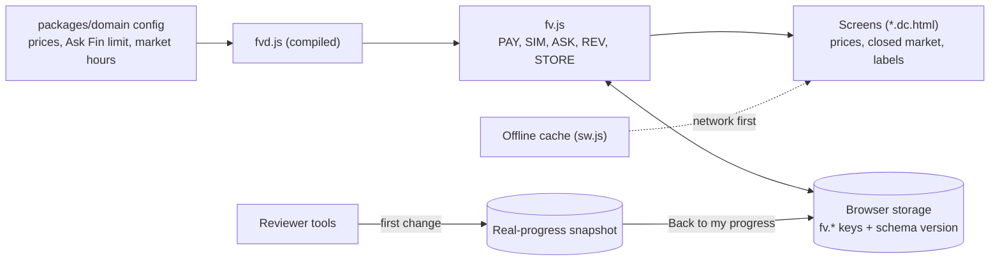

# Prototype settings, labels and stored data (Part 1 of 5)

*   **Author:** Powellgraham5
*   **Status:** Draft
*   **Date:** 2026-11-08

--------------------------------------------------------------------------------

## Overview

This is the first of five designs for the next round of Finvora Phase 1 changes, decided as D1 to D20 in [docs/open-questions.md](docs/open-questions.md) after a seven-reviewer EGM review ([concepts_brief.md](concepts_brief.md)). It covers the shared foundations the other four designs depend on: the Plus price and Ask Fin limit, practice market hours, labels for simulated content and the Practice Market, the reviewer code and its separate demo copy, how stored data changes safely in testers' browsers, and how returning testers get the updated app. The other four designs (Review what I missed, Ask Fin grounded answers, Plus features, admin on phones) follow once this one is approved.

Everything stays in the browser, as in the rest of Phase 1: no backend, no paid service, no live AI.

## The Problem

The prototype works end to end, but the review found that some of its foundations either contradict the owner's decisions or can stop a tester in their tracks:

*   **Prices disagree in three places.** The tested domain config says ₦2,500 a month, the app code charges ₦1,500, other figures are written directly into screens, and a price an admin once saved in a browser overrides all of them. The decided price (D1) is ₦5,999 a month and ₦65,989 a year.
*   **Market hours can strand a tester.** The practice market opens only on weekdays, 10:00 to 14:30 Lagos time (D3). A tester trying it in the evening or at a weekend meets a closed market with no clear way forward, which breaks the success test (D11). Prices also move over weekends while the market is closed, which is confusing.
*   **Simulated content is not clearly marked.** Ask Fin's answers are scripted and most company figures are made up, but nothing on screen says so consistently. The owner chose quiet labels (D5) and a named Practice Market (D17).
*   **Reviewer tools are open to everyone.** They are linked from Settings and the sign-in screen, so any tester can find them, switch themselves to Plus or jump their progress. The owner chose a reviewer code (D7), and a separate demo copy so a demo never changes a tester's real progress (D20).
*   **Stored data has no plan for change.** Progress, plan, Ask Fin usage and settings live in the browser's storage with no version or migration rules. The upcoming designs add new stored data (for example missed questions), and the offline cache can keep serving old files to a returning tester, so the same tester session could mix old and new prices or screens.
*   **Phone text does not follow the phone's text size.** Phone screens are scaled to fit the width, so the phone's own text-size setting has no effect (D15, WCAG 1.4.4).

The proposed solution sets one source for each setting, adds a clear closed-market experience, introduces one shared label style and the Practice Market entrance, gates reviewer tools behind a code with a separate demo copy, versions the stored data with safe upgrades, makes returning testers load the new version, and lets the lesson path follow the phone's text size.

## Goals

*   **One price everywhere.** Every screen, checkout, receipt email and admin page shows ₦5,999 a month and ₦65,989 a year, from a single source in the tested domain config, in a clean browser and in a browser that has old saved prices.
*   **Ask Fin limit of 5 a day** from the same single source (D2), with its tests checking the value 5 directly.
*   **No tester is ever stuck on market hours.** When the market is closed, the tester sees when it opens (Lagos time), can queue a practice order for the open, and is offered a lesson. Prices move only on trading days (D12).
*   **Simulated content is always recognisable** without breaking the experience: the Practice Market has one clear entrance line and a small icon on its screens, Ask Fin answers carry "Example answer from the Finvora Library" with a link, and checkout says "No money is taken" (D5, D17).
*   **Testers cannot reach reviewer tools by accident.** No visible links; the tools open only with the reviewer code (D7). Anything done there changes a demo copy, and "Back to my progress" restores the tester's real data exactly (D20).
*   **Stored data upgrades safely.** Existing testers keep their progress after the update; new fields get sensible defaults; corrupt or old data never crashes a screen.
*   **Returning testers get the new version** on their next visit at the latest, without clearing anything themselves.
*   **The lesson path follows the phone's text size** (D15) without breaking layout at 280px to 430px wide.

## Non-Goals

*   **Review what I missed, Ask Fin's new answering, the Plus features and admin on phones.** Each has its own design (Parts 2 to 5). This design only prepares the stored data and labels they rely on.
*   **Real security.** The reviewer code is checked in the browser and can be found by anyone who reads the page source. It hides the tools from testers; it does not protect them. Phase 2 needs real staff accounts.
*   **A reviewer-mode banner or special handling of the test sign-in codes.** The owner rejected these (D20).
*   **An activity log or session recording.** The owner judges success by testing the app personally (D19).
*   **An NGX public-holiday calendar.** Phase 1 treats every weekday as a trading day unless the owner asks otherwise.
*   **Text-size support on every screen in this part.** This part covers the lesson path; other screens follow in a later step of D15.
*   **Backend, real payments, real market data or live AI.**

## Decisions Made in Drafting

*   **Holidays:** the practice market treats every weekday as a trading day. No public-holiday calendar in Phase 1.
*   **Old orders:** a tester who bought Plus at an old price keeps that order; their receipt and plan screen show the price they paid.
*   **Reviewer code entry:** a small "Reviewer code" field on the Help and feedback screen.

## Technical Plan (Architecture)

All changes stay in the browser. The tested TypeScript packages (`packages/domain`, compiled into `fvd.js`) remain the source of rules and values; `fv.js` reads them; the screens (`*.dc.html` boards) read `fv.js`. Board edits are made by the wiring scripts in `apps/prototype/tools/`, so a rebuild never loses them.

### 1. One source for prices and the Ask Fin limit

*   The domain config holds the Plus prices in kobo: 599900 a month and 6598900 a year, with the placeholder flag turned off. A domain test checks that yearly equals 11 times monthly. The Ask Fin free limit stays at 5, with a test that checks the number itself.
*   `fv.js` stops keeping its own price figures. Checkout, the admin plans page and every screen read the price from the config through one function, formatted by the existing naira formatter.
*   Price figures written directly into screens are replaced by values filled in from that function. A search for "₦" across the screens and wiring scripts is part of the check.
*   An order keeps the amount it was created with, so old receipts show what was paid.
*   A price an admin saves in the admin plans page still overrides the config in that browser (that is the point of the page), but saved prices equal to the old defaults (₦1,500, ₦15,000, ₦2,500, ₦25,000) are dropped by the storage upgrade in section 5.

### 2. Market hours that never strand a tester

*   Opening rules are unchanged: weekdays, 10:00 to 14:30 Lagos time, always worked out in Lagos time whatever the phone's own time zone.
*   A new function gives the next opening time, for example "Mon 10:00".
*   When the market is closed, the practice market screens show one notice: "Practice Market closed. Opens Mon 10:00 Lagos time." with two actions: queue the order (the existing queue fills it at the next open) and "Do a lesson while you wait".
*   Prices move once per trading day instead of once per calendar day, so a weekend no longer changes a portfolio while the market is closed. Existing holdings keep their values; only the counting of days changes.

### 3. One label style and the Practice Market

*   One shared label component: a small icon plus short text, at least 4.5:1 contrast, read by screen readers. Its wording lives in one list so every screen says the same thing.
*   **Practice Market:** the simulator's made-up companies are presented as "Practice Market". Its home screen opens with one line: "Practice Market: made-up companies, virtual naira, no money at risk." Company, trade and history screens show the small Practice Market icon beside the title.
*   **Ask Fin:** every answer, decline and "no figures" reply carries "Example answer from the Finvora Library", linked to the article it came from when there is one. Part 3 changes how answers are found; this part adds the label.
*   **Checkout:** the plans and checkout screens show "No money is taken. This is a practice checkout."
*   Real NGX companies on the Markets screens show descriptions only, no figures, so they need no label.

### 4. Reviewer code and the demo copy

*   The Settings and sign-in links to Reviewer tools are removed. The Help and feedback screen gets a "Reviewer code" field. The right code unlocks Reviewer tools in that browser and brings back the Settings link; a wrong code says "That code isn't right."
*   The unlock is stored under its own key, outside the `fv.` keys that "Clear everything" removes.
*   Opening Reviewer tools without the unlock goes to the Help screen.
*   **Demo copy:** the first time a reviewer changes anything (plan, progress, market, checkout result), the app first saves a snapshot of all the tester's `fv.` data under a separate key. Every change then happens on the live data as now. A "Back to my progress" button on the Reviewer tools page puts the snapshot back exactly and deletes it. While a snapshot exists, the button stays visible on that page.
*   The code is checked in the browser, so it hides the tools rather than securing them. This is written into the README and the handover notes.

### 5. Stored data that upgrades safely

*   A single stored schema version (starting at 2) and one upgrade step that runs before anything reads storage.
*   Rules for every change, now and in Parts 2 to 5: add new fields with defaults instead of renaming or removing; keep fields the code does not know; never crash on missing or corrupt data (fall back to defaults, as `fv.js` already does).
*   Upgrade from 1 to 2: drop saved admin prices equal to the old defaults; add an empty missed-questions record to progress for Part 2; record the version.

### 6. Returning testers get the new version

*   The offline cache already fetches pages from the network first and only uses stored copies offline, so online testers already load new files.
*   Two gaps are closed: a new offline-cache version takes over at once instead of waiting for every open tab to close, and network requests skip the browser's own short-term cache so they always check for the newest file.
*   After an update takes over, the page shows a short toast, "Finvora was updated.", once.

### 7. Lesson path follows the phone's text size

*   Today each phone screen is a 390-pixel design scaled to the screen width, so the phone's text setting has no effect.
*   On the lesson path (lesson steps, the after-lesson screens and the lesson summary), the app reads the phone's preferred text size. If it is larger than normal, the screen is laid out at a narrower design width before scaling, so the text renders larger and the layout reflows downwards instead of shrinking. At normal size nothing changes.
*   **Risk to verify on a real phone:** browsers report the phone's text setting differently (some change the page's base font size, others zoom text separately). The build step includes checking on an Android phone with large text, and the fallback is the browser's pinch zoom, which keeps working.

## Open Questions

*   None for this part. New questions found while planning the implementation will be added here.
