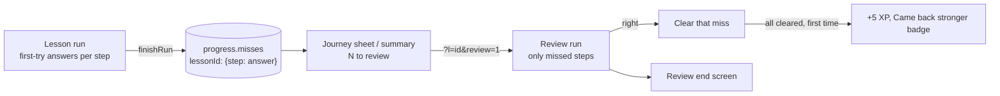

# Review what I missed (Part 2 of 5)

*   **Author:** Powellgraham5
*   **Status:** Draft
*   **Date:** 2026-11-08

--------------------------------------------------------------------------------

## Overview

Learners replay lessons to relearn what they did not understand, or to refresh before something like a job interview (owner, 8 Nov). Today a replay plays the whole 7-step lesson again. This design turns replay into **Review what I missed**: the learner practises only the questions they got wrong, and fixing them all is rewarded (D8, D14 and D16 in [docs/open-questions.md](docs/open-questions.md)). Full replay stays as a small secondary option.

It builds on Part 1 ([prototype-settings-labels-storage.md](docs/designs/prototype-settings-labels-storage.md)), whose storage upgrade already added an empty missed-questions record to every learner's progress.

## The Problem

*   **Replay does not match why people replay.** A learner who missed one calculation has to sit through all seven steps, including the four they already know.
*   **Misses are thrown away.** The app records which questions were right on the first try during a lesson, but deletes that record when the lesson ends. Only the overall percentage survives, so nothing knows which questions to practise.
*   **Getting better is not rewarded.** Replays earn 2 XP once a day whatever happens. The game rules already have an "improvement" reward (5 XP) and a "Came back stronger" badge, but the app never uses them; the badge is always locked.
*   **Learners who finished lessons before this change have no stored misses.** They need a sensible option too.

## Goals

*   **Misses are kept.** When a lesson ends, every question answered wrong on the first try is stored for that lesson, with the learner's answer.
*   **Review what I missed** plays only those questions, in lesson order, with the usual feedback and explanations.
*   **A miss clears when answered right** in a review. Questions still wrong stay for next time.
*   **Fixing every miss in a lesson** gives +5 XP once per lesson, ever, and unlocks the "Came back stronger" badge.
*   **Reviewing still counts for the day:** the existing 2 XP once per lesson per day and a streak day apply to reviews, as they do to replays now.
*   **Full replay stays** as a small link, and is the only option for a lesson with no stored misses (a perfect score, or a lesson finished before this change).
*   **The rules live in the tested domain package** so they carry into Phase 2, with tests for each.
*   **Clear entry points:** the journey's finished-lesson node and the lesson summary show how many questions are waiting ("2 to review").
*   **A review has its own end screen,** in the style of the after-lesson celebrations: when every miss is fixed, a "Came back stronger" moment (Fin powers up, the badge pops in, +5 XP rolls up); when some remain, a calm screen saying how many are left. Mock-up first.

## Non-Goals

*   **Spaced repetition** ("still remembered days later" checks). Rejected by the owner (D16).
*   **A separate quick refresher** of explainer steps. Full replay already does this job.
*   **Reviewing boss, daily-question or micro-module misses.** This part covers the six World 1 lessons only.
*   **Changing lesson content or question wording.**
*   **New visual style.** Screens reuse the existing lesson steps; the new entry points get a mock-up before they are built.

## Decisions Made in Drafting

*   **Journey entry:** tapping a finished lesson with misses opens a small sheet: "Review what I missed (N)" and "Replay the whole lesson". A lesson without misses goes straight to the full replay, as today.
*   **One miss per step:** order and match steps count as one question each.
*   **Best score unchanged by reviews:** the best score records first attempts and full replays; reviews only clear misses.
*   **Review end screen:** its own celebration, mock-up first (owner, 8 Nov).

## Technical Plan (Architecture)

### 1. Rules in the domain package

New tested functions in `packages/domain/src/learning.ts`, so the rules carry into Phase 2:

*   **Record misses** after a full lesson or full replay: take the steps answered wrong on the first try and add them to that lesson's misses, keeping the learner's answer. A step answered right in a full replay clears its miss.
*   **Plan a review:** given a lesson's flow and its misses, return the missed steps in lesson order.
*   **Apply a review:** steps answered right are cleared; steps still wrong stay. Returns how many remain and whether this review fixed the last one.
*   **Reward:** fixing the last miss of a lesson gives `XP.improvement` (5) once per lesson, ever; it is remembered so it never pays twice. The usual practice reward (2 XP once per lesson per Lagos day) and the streak day apply to every review and replay.

### 2. Stored data

*   `progress.misses[lessonId] = { stepKind: givenAnswer }`, added empty by the Part 1 upgrade. Step kinds (choice, order, match, scenario, calc) are stable keys within a lesson.
*   `progress.fixed[lessonId] = true` once the +5 has been paid, so it is paid once ever.
*   Lessons finished before this change have no misses; they offer full replay only.

### 3. Running a review

*   A review is a lesson run with a review flag and the list of steps to play. The lesson step screens already move to the next step in the flow; in a review they move to the next missed step instead, and the progress bar counts only the review's steps ("1 of 2").
*   Explainer, myth and compare steps are skipped in a review; they have no answers.
*   The halfway cheer and "in a row" label work as in a normal lesson.
*   At the end, the review goes to its own end screen instead of the lesson celebration.

### 4. Screens

*   **Journey sheet** (new): on a finished lesson with misses, a small sheet with the lesson title, "Review what I missed (N)" and "Replay the whole lesson".
*   **Lesson summary:** when the lesson has misses, a "Review what I missed (N)" button under the existing review of answers.
*   **Review end screen** (new board, built like the celebration screens): all fixed: Fin powers up, "Came back stronger" badge pops in, +5 XP rolls up, "Back to the journey"; some left: "N still to practise", what was fixed, "Back to the journey".
*   **History** names reviews "Lesson review".
*   **Me, Achievements:** the "Came back stronger" badge unlocks when a lesson's misses are all fixed.

## Alternatives Considered

*   **Keep full replay only.** Rejected: it makes a learner repeat what they already know, which does not serve relearning or interview preparation.
*   **A separate quick refresher of explainer steps.** Rejected by author (D16): full replay already covers it.
*   **Spaced repetition ("still remembered days later").** Rejected by author (D16): too much for a prototype.
*   **Pay the +5 bonus every time all misses are fixed.** Rejected: a learner could miss on purpose, then fix, to farm XP. Once per lesson, ever, rewards real improvement only.
*   **Let reviews raise the best score.** Rejected: a review plays only a few steps, so its percentage is not comparable with a full lesson.
*   **Count each part of an order or match step as its own miss.** Rejected: steps are answered as one action, and the lesson already scores them as one.
*   **Keep the rules in the app's glue code (`fv.js`).** Rejected: untested, and they would not carry into Phase 2.
*   **Go straight to the review from the journey, with a replay link inside.** Rejected by author: a small sheet with both choices is clearer.
*   **Name it "Practise my mistakes".** Rejected by author (D16): "Review what I missed" reads as less of a telling-off.

## Open Questions

*   None for this part.
