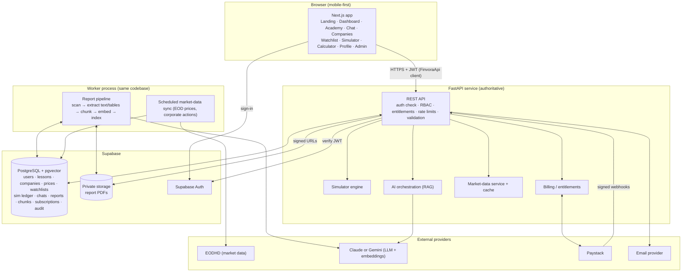
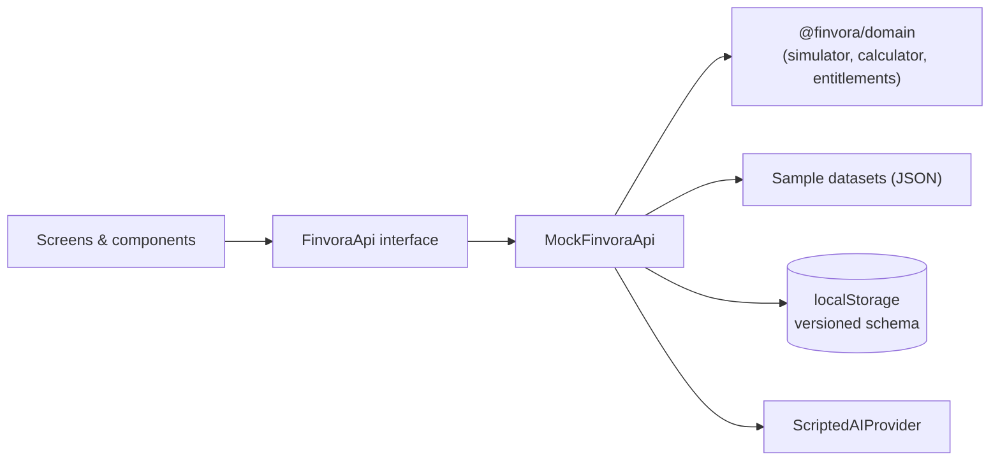

# Finvora — Technical Proposal: Engineering Foundation

**Status:** Draft for review. Nothing has been built yet.
**Covers:** Stage 1 (five-week interactive prototype) and how it becomes Stage 2 (the production platform) without a rewrite.
**Sources:** *Finvora Developer Brief*, *Finvora PRD v1.1 (Interactive Prototype)*, the architecture sketch (Frontend → Backend → Database / External providers), the *LLM Software Engineering Framework*, and the initial engineering instructions.

Sections marked **DECISION** need your answer before or during Week 1. They are all listed in §12.

---

## 0. Summary

| Concern | Prototype (Stage 1) | Production (Stage 2) |
|---|---|---|
| Frontend | Next.js + TypeScript + Tailwind CSS | Same codebase |
| Backend | **None deployed.** A typed API contract with a mock implementation that runs in the browser | FastAPI (Python) implementing the same contract |
| Business logic | Pure TypeScript domain package (simulator, calculator, entitlements), fully unit-tested | FastAPI is authoritative. The same golden test cases prove both implementations agree |
| Data | Versioned JSON sample datasets. User state in `localStorage` | PostgreSQL (Supabase) with pgvector |
| Auth | Simulated personas (Free / Premium / Admin) | Supabase Auth. FastAPI checks the JWT and enforces roles and entitlements |
| AI | Scripted provider with the same response shape as production, including citations | RAG over uploaded reports, using Claude or Gemini behind a provider interface |
| Market data | Synthetic sample prices | EODHD adapter behind a `MarketDataProvider` interface, once licensing is confirmed |
| Payments | Simulated checkout | Paystack subscriptions, verified by webhooks |
| Hosting | Free static/edge hosting, staging URL | Frontend host + container host for the API and worker + managed Postgres |
| Recurring cost | **About ₦0 / $0** (a domain is optional) | Paid by the client, approved before integration (§10) |

The rule that prevents a rewrite: **the UI never calls data sources directly.** Every screen goes through a typed `FinvoraApi` client. In Stage 1 that client is backed by mocks. In Stage 2 it is backed by HTTP calls to FastAPI. Screens, components and routes do not change.

---

## 1. Technology stack

### 1.1 Frontend: Next.js (App Router) + TypeScript + Tailwind CSS
- **Why:** The brief names React/Next.js. Next.js gives us file-based routing for 17+ screens, server rendering of static content (landing page, lessons, company pages) so low-end Android phones get HTML before JavaScript, and a mature ecosystem.
- **TypeScript in strict mode:** money and quantity types are guarded by the compiler, not by convention.
- **Tailwind CSS:** design tokens for the dark-mode Finvora brand, no runtime CSS-in-JS cost, small CSS output.
- **UI primitives: Radix UI** (or shadcn/ui, which is built on Radix). Dialogs, menus, tabs and toasts come with keyboard and screen-reader behaviour already done. We copy in only the components we use.
- **Charts: TradingView `lightweight-charts`** (Apache-2.0, about 45 KB gzipped, canvas-based, built for financial series) for price charts, and hand-written SVG for sparklines. We avoid Recharts and Chart.js because they are heavy for low-end phones.
- **Forms and validation: Zod.** The same schemas validate mock API inputs now and are mirrored by Pydantic models in FastAPI later.
- **Client state: TanStack Query** for server-shaped data (it caches equally well with mocks and with HTTP), plus a small store for UI-only state.

### 1.2 Backend (Stage 2): Python 3.12 + FastAPI
- **Why:** The brief names FastAPI. Python has the strongest tooling for what production needs: PDF text and table extraction (PyMuPDF, pdfplumber, Camelot), OCR (Tesseract), chunking, embeddings and LLM SDKs.
- **Supporting libraries:** Pydantic v2 (contracts), SQLAlchemy 2 + Alembic (data access and migrations), `httpx` (provider clients), `structlog` (structured logs).
- **Background work:** a Postgres-backed job queue (a `jobs` table claimed with `SELECT … FOR UPDATE SKIP LOCKED`, or the `procrastinate` library). **No Redis** is needed at our scale, which means one less paid service.

> **Why no backend in the prototype?** The PRD puts real authentication and persistent production data out of scope for Stage 1. A deployed backend would add hosting cost, cold starts on free tiers (bad for client review) and roughly a week of work, without changing what reviewers see. We still get the long-term benefits through contract-first design and shared golden tests (§3, §8). **DECISION D1** below lets you choose otherwise.

### 1.3 Database: PostgreSQL 16 (Supabase in production)
- Relational integrity (foreign keys, unique constraints, check constraints, transactions) protects the simulator ledger and subscriptions.
- The **pgvector** extension stores report embeddings in the same database, so we don't need a separate vector database service. **Postgres full-text search** gives keyword matching for hybrid retrieval.
- Supabase bundles Postgres, Auth, Storage, backups and Row-Level Security in one account, which suits a small team and budget. Plain Postgres + SQLAlchemy keeps us portable to another host if needed.

### 1.4 Authentication
- **Prototype:** a persona switcher (Free, Premium, Admin) behind realistic sign-in and sign-up forms with real validation. It is labelled "Demo sign-in". No credentials are stored.
- **Production:** **Supabase Auth** (email + password, magic link, and optionally Google sign-in). The frontend gets a session. FastAPI verifies the JWT signature on every request and loads the user's role and entitlements **from the database, never from the token's client-editable claims**. Admins must use MFA.
- **Alternatives considered:** Clerk (polished but expensive per active user at scale), Auth0 (expensive), building auth ourselves in FastAPI (more security risk and maintenance). Supabase Auth has the lowest cost and risk.

### 1.5 File storage
- **Production:** a private Supabase Storage bucket (S3-compatible) for report PDFs. There is no public access. Downloads use short-lived signed URLs issued by FastAPI after an authorisation check.
- **Prototype:** no files leave the browser. The Admin upload demo validates the chosen file locally and then simulates the processing pipeline.

### 1.6 Hosting
| Layer | Prototype | Production |
|---|---|---|
| Frontend | **Cloudflare Pages** or **Netlify** free tier (both allow commercial use; Vercel's free Hobby plan does not) | Vercel Pro, Cloudflare or Netlify paid tier |
| API + worker | — | A container host (Render, Railway or Fly.io), always-on instance, two processes from one image |
| Database / Auth / Storage | — | Supabase Pro (the free tier pauses idle projects and has no backups suitable for production) |

### 1.7 Testing and quality tooling
Vitest (unit), React Testing Library (components), Playwright (browser and end-to-end), `@axe-core/playwright` (accessibility), Lighthouse CI (performance budgets), ESLint + Prettier, `tsc --noEmit`. Stage 2 adds pytest, Testcontainers Postgres, Schemathesis (contract fuzzing against the OpenAPI spec), Ruff + mypy, `pip-audit`, and an OWASP ZAP baseline scan against staging. Secret scanning uses gitleaks plus GitHub secret scanning.

### 1.8 CI/CD: GitHub Actions
Free for this volume. Each pull request runs lint, typecheck, tests and the build. Preview deployments are created per PR.

---

## 2. System architecture

### 2.1 Production target



### 2.2 How the parts communicate
- **Browser → API:** JSON over HTTPS. The access token travels in the `Authorization` header. The API is the only component holding provider keys. The browser never talks to EODHD, the LLM, or Paystack's secret APIs.
- **API → Database:** SQLAlchemy over a pooled connection. Multi-row operations (trades, subscription changes) run in a single transaction.
- **API → Worker:** the API writes a `job` row (for example "process report 123"). The worker claims it, runs it, and updates its status. Because jobs are retryable and idempotent, a crash part-way through leaves a report in a known `failed` state that an admin can retry.
- **Market data:** the worker pulls end-of-day prices and corporate actions from EODHD on a schedule and stores them. **User requests read only from our database or cache, never from EODHD directly.** This controls cost, survives provider outages, and makes licensing terms easier to honour.
- **AI chat:** API → retrieve evidence (Postgres) → call the LLM → validate citations → stream the answer to the browser (Server-Sent Events) → persist the message and citations → count usage.
- **Payments:** Checkout is initialised by the API and completed on Paystack's hosted page. **Entitlements change only when a signature-verified webhook arrives**, never on the browser's redirect.

### 2.3 Prototype architecture (Stage 1)



In Stage 2 we add `HttpFinvoraApi`, which implements the same interface against FastAPI. A single configuration value chooses which implementation is used. The mock stays in the codebase permanently for Storybook-style development, demos and frontend tests.

The mock adds artificial latency and can be configured to inject errors. This makes sure the loading, empty and error states the PRD requires are actually built and testable.

---

## 3. Project structure

One monorepo (pnpm workspaces for TypeScript, uv for Python):

```
finvora/
├── apps/
│   ├── web/                      # Next.js frontend
│   │   ├── src/app/              # Routes: (marketing), (auth), (app), admin
│   │   ├── src/features/         # Feature modules: academy, chat, companies, watchlist,
│   │   │                         #   simulator, calculator, billing, profile, admin
│   │   ├── src/components/ui/    # Accessible design-system primitives (Button, Dialog, …)
│   │   ├── src/lib/api/          # FinvoraApi interface + mock and http implementations
│   │   └── tests/e2e/            # Playwright journeys + axe checks
│   └── api/                      # FastAPI (scaffolded in Stage 2)
│       ├── app/routers/          # HTTP layer only: parse, authorise, call service
│       ├── app/services/         # Business logic (simulator, entitlements, chat, billing)
│       ├── app/providers/        # Adapters: market_data/, llm/, payments/, email/
│       ├── app/pipeline/         # Report ingestion stages
│       ├── app/db/               # SQLAlchemy models, Alembic migrations
│       └── tests/
├── packages/
│   ├── domain/                   # Pure TypeScript business rules, no framework or I/O
│   │                             #   money.ts, simulator.ts, historicalCalculator.ts,
│   │                             #   entitlements.ts, fees.ts
│   ├── contracts/                # openapi.yaml (source of truth for the API)
│   │                             #   + generated TypeScript types
│   └── sample-data/              # Versioned demo datasets + generator script
│                                 #   companies, daily prices, dividends, lessons,
│                                 #   glossary, scripted chat answers
├── testdata/golden/              # Language-neutral JSON test cases for the simulator and
│                                 #   calculator. Both the TS and Python suites must pass them
├── docs/
│   ├── TECHNICAL_PROPOSAL.md     # This document
│   ├── adr/                      # Architecture Decision Records (one per major decision)
│   └── domain/                   # Business rules, state machines, glossary
├── .github/workflows/            # CI pipelines
└── README.md
```

**Boundaries that matter**
- `packages/domain` must not import React, Next.js, or storage. This keeps business rules testable and portable.
- `apps/web/src/features/*` may use `domain` and the `FinvoraApi` interface, but never a concrete mock or HTTP implementation directly.
- `packages/contracts/openapi.yaml` changes go through review. Breaking changes need a new version.
- In `apps/api`, routers contain no business logic and services contain no HTTP code.

---

## 4. Database design (production)

Money is stored as **integer kobo** (`BIGINT`; ₦1 = 100 kobo). Share quantities are integers. Floats are never used for money. All timestamps are `timestamptz` in UTC. "Today" for daily limits uses the **Africa/Lagos** timezone.

### 4.1 Entities

**Identity and access**
| Table | Key fields | Rules |
|---|---|---|
| `users` | `id` (= auth user id), `email` (unique), `display_name`, `role` (`user` \| `admin`), `status` (`active` \| `suspended` \| `deleted`), `created_at` | `role` can only be changed by an admin, and the change is audited |
| `user_preferences` | `user_id` PK/FK, `theme`, `email_opt_in`, `default_landing` | Owner only |

**Subscriptions and billing**
| Table | Key fields | Rules |
|---|---|---|
| `plans` | `code` (`free` \| `premium_monthly` \| `premium_annual`), `price_kobo`, `features` (JSON), `ai_daily_limit` | Admin-managed |
| `subscriptions` | `user_id`, `plan_code`, `status`, `provider`, `provider_customer_code`, `provider_subscription_code` (unique), `current_period_end`, `cancel_at_period_end` | Written only by the billing service and webhooks. Read by the owner |
| `payment_events` | `provider_event_id` (**unique**, for idempotency), `type`, `payload`, `processed_at` | Append-only |

Entitlements are **computed** (`plan` + `status` + `current_period_end` → feature set). They are not stored as client-editable flags.

**Learning**
| Table | Key fields |
|---|---|
| `modules` | `slug`, `title`, `order` |
| `lessons` | `slug` (unique), `module_id`, `title`, `body_md`, `reading_minutes`, `tier_required`, `published` |
| `glossary_terms` | `term` (unique), `definition`, `example` |
| `lesson_progress` | (`user_id`, `lesson_id`) **unique**, `status` (`started` \| `completed`), `completed_at` |

**Market**
| Table | Key fields | Notes |
|---|---|---|
| `companies` | `ticker` (unique), `name`, `sector`, `description`, `shares_outstanding`, `is_active` | |
| `price_bars_daily` | PK (`company_id`, `trade_date`), `open/high/low/close_kobo`, `volume`, `source` | Raw, unadjusted closes |
| `corporate_actions` | `company_id`, `type` (`cash_dividend` \| `bonus_issue` \| `split` \| `rights`), `ex_date`, `pay_date`, `amount_kobo` or `ratio` | Needed for correct historical returns |
| `company_summaries` | `company_id`, `report_id`, `body`, `status` (`draft` \| `approved`), `generated_by`, `approved_by` | AI drafts need human approval before they are shown |

**Watchlists**
| Table | Key fields | Rules |
|---|---|---|
| `watchlists` | `user_id`, `name` | Owner only. One default list in v1 |
| `watchlist_items` | (`watchlist_id`, `company_id`) **unique**, `added_at` | Adding the same company twice does nothing (idempotent) |

**AI chat**
| Table | Key fields |
|---|---|
| `chat_conversations` | `user_id`, `title`, `origin` (`chat` \| `lesson:<slug>` \| `company:<ticker>`) |
| `chat_messages` | `conversation_id`, `role`, `content`, `status`, `provider`, `model`, `input_tokens`, `output_tokens` |
| `message_citations` | `message_id`, `chunk_id`, `report_id`, `page`, `quote` |
| `ai_usage_daily` | (`user_id`, `usage_date`) **unique**, `count` (incremented atomically) |

**Reports and retrieval**
| Table | Key fields | Rules |
|---|---|---|
| `reports` | `company_id`, `period_type` (`annual` \| `quarterly`), `fiscal_year`, `fiscal_period`, `storage_key`, `sha256` (**unique**, prevents duplicate uploads), `page_count`, `status`, `uploaded_by`, `published_at` | Admin write. Users see only `published` reports |
| `report_jobs` | `report_id`, `stage`, `status`, `attempts`, `last_error` | Worker-managed |
| `document_chunks` | `report_id`, `page_start`, `page_end`, `section`, `content`, `tsv` (full-text), `embedding vector(n)` | Never listed raw to users. Shown only as citation snippets |
| `financial_facts` | `company_id`, `report_id`, `metric` (e.g. `net_interest_income`), `period`, `value`, `unit`, `currency`, `page`, `verified_by` | Extracted table values. Must be verified before AI may quote them as figures |

**Simulator**
| Table | Key fields | Rules |
|---|---|---|
| `sim_accounts` | `user_id`, `status` (`active` \| `archived`), `starting_cash_kobo`, `cash_kobo` CHECK ≥ 0, `version` | Partial unique index: one `active` account per user |
| `sim_trades` | `account_id`, `company_id`, `side`, `quantity` CHECK > 0, `price_kobo`, `fees_kobo`, `net_amount_kobo`, `realized_pl_kobo`, `executed_at`, `idempotency_key` (**unique per account**) | Append-only |
| `sim_holdings` | (`account_id`, `company_id`) unique, `quantity` CHECK ≥ 0, `cost_basis_kobo` | Updated in the same transaction as the trade. Can always be rebuilt from `sim_trades` |

**Operations**
| Table | Key fields | Rules |
|---|---|---|
| `audit_log` | `actor_id`, `action`, `target_type`, `target_id`, `metadata`, `ip_hash`, `created_at` | Insert-only. Database permissions deny UPDATE and DELETE |
| `jobs` | `kind`, `payload`, `status`, `run_after`, `attempts`, `locked_by` | Worker queue |

### 4.2 Data-access rules
1. **Ownership:** users can read and write only rows where `user_id` = their own id (watchlists, progress, chats, simulator, preferences). This is enforced in the FastAPI service layer **and** by Postgres Row-Level Security as defence in depth.
2. **Public reference data** (companies, prices, published lessons, approved summaries) can be read by anyone. Some fields are restricted by entitlement.
3. **Admin-only:** report upload/publish, company edits, summary approval, user role changes. All of these are audited.
4. **System-only:** `payment_events`, `subscriptions` writes, `ai_usage_daily`, `jobs`. These are written by the backend's service role, never directly by user requests.
5. **Premium-gated content** is filtered on the server. Premium data is never sent to the browser and then hidden in the UI.

In the prototype, the same TypeScript types and `localStorage` keys mirror these entities, so the shape of the data is settled early.

---

## 5. Security architecture

| Area | Controls |
|---|---|
| **Authentication** | Supabase Auth. Short-lived access tokens with refresh rotation. JWT signature and expiry checked on every API call. Email verification before Premium checkout. MFA required for admins. Login rate limiting |
| **Authorisation** | Role-based (`user`/`admin`) plus ownership checks plus entitlement checks, all inside FastAPI dependencies applied to every route. A route without an explicit policy fails a test (deny by default). RLS as a second layer |
| **Premium entitlements** | Computed on the server from subscription state. Premium endpoints return `403` with a machine-readable `upgrade_required` code. The AI daily limit is enforced by an atomic `INSERT … ON CONFLICT DO UPDATE … WHERE count < limit RETURNING` before calling the LLM, so the limit cannot be bypassed by sending requests in parallel |
| **API keys & secrets** | Stored only in the backend host's secret store, one set per environment. Nothing secret uses a `NEXT_PUBLIC_*` variable. Keys are rotated when someone leaves. gitleaks runs in CI. Provider keys have the lowest privileges and spending caps the provider supports |
| **Uploaded documents** | Admin-only endpoint. Checks: size limit (e.g. 50 MB), page limit, content-type **and** PDF signature bytes, SHA-256 de-duplication. Files go to a private bucket under a random key (never the user's filename). Parsed in the worker process, never in the request path. PDFs with encryption or JavaScript are rejected. Optional ClamAV scan. Downloads use signed URLs that expire in minutes |
| **AI-specific** | Retrieved document text is treated as *data, not instructions* (clearly delimited in the prompt). Citations are validated against the chunks actually retrieved. Output is rendered as sanitised Markdown (no raw HTML). Per-user rate limits and token caps. Disclaimer: "educational, not financial advice" |
| **Payments** | Paystack webhook signature (HMAC) verified. Event ID de-duplicated. Amount and plan re-checked against our `plans` table. Card data never touches our servers |
| **User data & privacy** | We collect the minimum (email, display name, preferences, learning and simulator activity). TLS everywhere. Encryption at rest (provider default). Logs hold user IDs, not emails or chat content. Self-service account deletion and data export. Retention policy written down. **Nigeria Data Protection Act 2023** obligations, including cross-border transfer (Supabase has no Nigerian region), need review (§12) |
| **Web hardening** | Content-Security-Policy, HSTS, `X-Content-Type-Options`, `Referrer-Policy`, `frame-ancestors 'none'`. Strict CORS allow-list. CSRF protection if cookies are used for auth. Inputs validated with Pydantic/Zod. Parameterised SQL only |
| **Supply chain** | Lockfiles committed. Dependabot. `npm audit` / `pip-audit` in CI. Any new dependency needs a justification in the PR |
| **Audit & monitoring** | Audit log for admin actions, role changes, report publication and subscription changes. Sentry for errors, with personal data scrubbed |

**Prototype honesty:** the prototype's Admin and Premium gates are demonstrations only. Anyone can switch persona in the browser. This is acceptable because there is no real data, and the demo banner says so. The production gates are on the server, as above.

---

## 6. AI architecture

### 6.1 One interface, two implementations
```ts
interface ResearchAssistant {
  ask(input: { conversationId?: string; question: string; context?: { lessonSlug?: string; ticker?: string } })
    : AsyncIterable<AnswerChunk>;   // streamed text, then citations, then usage
}
type Answer = {
  text: string;                      // Markdown
  citations: Citation[];             // { reportTitle, company, period, page, quote }
  groundedness: "grounded" | "insufficient_evidence" | "out_of_scope";
  disclaimer: string;
  usage: { remainingToday: number | null };
};
```
The chat UI is built against this shape from day one, including citation chips, the "insufficient evidence" state, the daily-limit state and streaming. Production then only swaps what sits behind it.

### 6.2 Prototype: `ScriptedAIProvider`
- About 40–60 curated question/answer pairs covering lesson topics (ETFs, ROI, dividends, P/E, inflation) and sample company questions. Each pair has illustrative citations that point to **sample** report pages and are visibly labelled "Sample source".
- Matching uses keyword/intent scoring, with a fallback reply ("In the full version I'll answer from company reports…").
- "Ask AI about this" from a lesson opens chat with the lesson context already filled in.
- Simulated streaming and typing delay. The free-tier daily counter is shown, enforced locally, so the upgrade prompt can be demonstrated.
- **No network calls and no API costs.**

### 6.3 Production: retrieval-augmented generation (RAG)
1. **Ingest (worker):** PDF → text with page numbers (PyMuPDF) → table detection and extraction (pdfplumber/Camelot) → OCR fallback for scanned pages → section-aware chunking (about 500–800 tokens, overlapping, tables kept whole, each chunk tagged with company, period and page) → embeddings → `document_chunks`.
2. **Facts:** key financial table values become `financial_facts` rows. An admin reviews them in the Admin Portal before publishing. Numerical answers come from verified facts first, because LLMs and table extraction both make mistakes with numbers.
3. **Retrieve:** a hybrid of vector similarity (pgvector) and keyword search (Postgres full-text), filtered by company and period detected in the question or passed as context. Results are merged and limited to the top-k.
4. **Generate:** a system prompt requires that the model answers *only* from the supplied evidence, cites chunk IDs, and declines when the evidence is insufficient. Plain-English explanation is encouraged. Investment recommendations are not allowed.
5. **Validate:** every cited ID must be among the retrieved chunks. Answers with missing or invalid citations are downgraded to "insufficient evidence". Citations are stored per message.
6. **Evaluate before launch:** a golden set of about 100 questions with known answers and source pages. We track citation precision, answer correctness and refusal accuracy, and run the set on every prompt, model or chunking change. **The same set is used to choose between Claude and Gemini** on quality and cost per answer (DECISION D7).
7. **Cost controls:** free-tier daily limits, maximum context size, caching of company summaries (generated once per report and approved, not per user view), and spending alerts on the provider account.

---

## 7. Simulator architecture

### 7.1 Rules (the same in the prototype's TypeScript and production's Python)
- **Account:** created with a starting virtual balance of **₦100,000** (decided in ADR 0001). The user can reset it: the old account is archived and a new one is created, so history is never lost.
- **Instruments:** sample NGX companies only. **Whole shares**, minimum 1. Long positions only: no short selling, no margin, no leverage.
- **Orders:** market orders that fill immediately at the current simulated price. (Limit orders could be a Stage 2 extension.)
- **Fees:** an optional, configurable fee schedule in basis points with a defined rounding rule, so users learn that real trades have costs. Exact NGX fee components are to be confirmed (DECISION D5). Default: on, with a simplified schedule clearly labelled "approximate".
- **Money:** integer kobo throughout. Rounding is half-up to the kobo, applied once per calculated amount.

### 7.2 Calculations
```
Buy  : gross = qty × price ; fees = fee(gross) ; cost = gross + fees
       require cost ≤ cash
       cash -= cost ; holding.qty += qty ; holding.costBasis += cost
Sell : require qty ≤ holding.qty
       gross = qty × price ; fees = fee(gross) ; proceeds = gross − fees
       avgCostPortion = round(holding.costBasis × qty / holding.qty)
       realizedPL = proceeds − avgCostPortion
       cash += proceeds ; holding.qty −= qty ; holding.costBasis −= avgCostPortion
Holding market value = qty × currentPrice
Unrealized P/L       = marketValue − costBasis           (and as % of costBasis)
Portfolio value      = cash + Σ marketValue
Total P/L            = portfolioValue − startingCash     (and as % of startingCash)
Day change           = Σ qty × (currentPrice − previousClose)
```
Cost basis uses the **weighted-average cost** method, which is easy to understand and explain in the Academy.

### 7.3 Invariants (each one is tested)
- `cash ≥ 0`. Holding `qty ≥ 0`. A holding with `qty = 0` has `costBasis = 0`.
- Holdings must always equal what you get by replaying every trade.
- `startingCash + Σ realizedPL − Σ cost basis of open positions = cash` (the ledger always balances).
- The same `idempotencyKey` cannot run twice. Double-tapping "Confirm" places one trade.
- A trade uses the price shown on the confirmation screen. If the price changed since, the user is asked to re-confirm (stale-quote check).

### 7.4 How prices move (DECISION D3)
"Prices change" needs to be deterministic so that it can be tested and demonstrated. Proposal: a **simulated market clock**. The sample dataset includes about two years of daily prices per company. The simulator's "today" starts at a fixed demo date, and a visible **"Advance market day"** control (plus an optional auto-advance demo mode) moves the clock forward through generated future days. Each company's daily move respects NGX's ±10% daily price-movement limit (to be confirmed). Same seed, same prices, so tests and demos repeat exactly.

### 7.5 Production
The same rules live in a FastAPI `SimulatorService`. Each trade runs in **one database transaction** that locks the account row (`SELECT … FOR UPDATE`), checks the rules, inserts into `sim_trades`, upserts `sim_holdings` and updates `cash_kobo`. Postgres CHECK constraints are a final safeguard. Prices come from the stored latest EOD close and are labelled "end-of-day, delayed". The golden JSON cases in `testdata/golden/` must pass in both Vitest and pytest.

### 7.6 Historical investment calculator (separate from the simulator)
Inputs: company, amount (₦), start date, end date. Rules:
- Use the close on the first trading day **on or after** the start date, and the last trading day **on or before** the end date. The UI shows the actual dates used.
- Validation: start date earlier than end date, both inside the available data, amount greater than zero and within a sensible maximum.
- `shares = floor(amount / startPrice)`, with the leftover cash shown. An "allow fractional shares (illustrative)" option is available.
- `endValue = shares × endPrice (+ leftover)`. Gain = `endValue − amount`. Also return % and annualised return (CAGR) for periods longer than one year.
- **Corporate actions:** bonus issues and splits adjust the share count, otherwise long-period results are wrong. Dividends are shown separately as "with dividends (cash)" for the Premium "historical payouts" feature (DECISION D6).
- A clear disclaimer: illustrative, sample data, past performance does not predict future returns.

---

## 8. Testing strategy

| Level | Tooling | What it proves | Prototype | Production |
|---|---|---|---|---|
| **Unit** | Vitest / pytest | Money arithmetic, fees and rounding, buy/sell rules, cost basis, P/L, calculator date logic and corporate actions, entitlement rules, AI daily-limit logic | ✅ ≥ 95% branch coverage on `packages/domain` | ✅ same rules plus services |
| **Golden (shared)** | JSON cases run in both languages | TS and Python simulator/calculator produce identical results | ✅ cases written | ✅ Python must pass them |
| **Property-based** | fast-check / Hypothesis | Invariants hold for random trade sequences (cash ≥ 0, ledger balances, holdings = replay) | ✅ | ✅ |
| **Component** | React Testing Library | Forms validate, error/empty/loading states render, focus management in dialogs | ✅ | ✅ |
| **Integration** | pytest + Testcontainers Postgres | Transactions, constraints, RLS, webhook idempotency, job retries | — | ✅ |
| **Contract** | Schemathesis + generated TS types | The API matches `openapi.yaml`, and the mock matches it too | ✅ types | ✅ |
| **Browser / E2E** | Playwright (Chromium + mobile emulation: Pixel 5 / Galaxy A-class viewport) | The PRD journeys: sign up → lesson → ask AI → company → watchlist → simulator buy/sell → portfolio → calculator → upgrade → admin upload | ✅ | ✅ against staging |
| **Accessibility** | axe on every route + manual keyboard and screen-reader pass (TalkBack, NVDA) | WCAG 2.2 AA | ✅ | ✅ |
| **Performance** | Lighthouse CI, mobile profile with 4× CPU throttle | Budgets (below) | ✅ | ✅ |
| **Security** | Authorisation matrix tests (every route × persona), ZAP baseline, gitleaks, dependency audit, upload fuzzing | No unauthorised access. Premium features cannot be reached by a free user. Bad PDFs are rejected | Partial (secrets, deps) | ✅ |
| **AI evaluation** | Golden Q&A set | Citation precision and refusal behaviour | — | ✅ gate before release |
| **Acceptance** | A checklist per screen, tied to PRD sections | The client signs off each screen | ✅ | ✅ |

**Negative paths tested explicitly:** buying with too little cash, selling more than held, double submission, stale price, invalid calculator dates, adding a duplicate watchlist item, hitting the AI limit, a Free persona opening Premium tools, a non-admin opening `/admin`, uploading a non-PDF or oversized file, and corrupted `localStorage` (reset safely to defaults with a notice).

**Performance budgets (prototype acceptance):** on Lighthouse mobile, Performance ≥ 85 on the landing page, dashboard and simulator; LCP < 2.5 s; CLS < 0.1; initial JS ≤ 200 KB gzipped per route. Usable from a 360 px wide screen upward.

---

## 9. Deployment strategy

| Environment | Purpose | Prototype | Production |
|---|---|---|---|
| **Local** | Development | `pnpm dev` (mock API) | + `docker compose` (Postgres+pgvector, API, worker) |
| **Preview** | One per pull request | Automatic frontend preview URL | Frontend preview against the staging API |
| **Staging** | Client review, QA, AI evaluation | `main` branch → staging URL | Separate Supabase project, test Paystack keys, sandbox data |
| **Production** | Real users | — | Promoted by release tag after staging sign-off |

**Practices**
- Trunk-based: short-lived branches → PR → required checks → merge to `main` → automatic staging deploy.
- Configuration through environment variables, validated at startup (the app refuses to boot when required configuration is missing). Each environment has separate projects and keys. **Staging never uses production data or live payment keys.**
- Database migrations (Alembic) run as a release step before the new API version takes traffic. Migrations are written to be backward-compatible (expand → migrate → contract) so a deploy can be rolled back.
- Health checks (`/healthz` liveness, `/readyz` checks DB connectivity). Rollback means redeploying the previous image or frontend build.
- Backups: Supabase daily backups plus point-in-time recovery on a paid tier. **A test restore every quarter**, written down. Report PDFs can be re-downloaded from the original sources, but bucket versioning is kept on.
- Observability: Sentry (frontend and backend), structured JSON logs, uptime monitoring, and alerts for webhook failures, failed jobs, AI spend and EOD sync failures.

---

## 10. Cost management

### 10.1 Prototype (target: zero recurring cost)
| Service | Choice | Cost |
|---|---|---|
| Code hosting + CI | GitHub (free minutes are enough) | Free |
| Frontend hosting | Cloudflare Pages or Netlify free tier | Free |
| AI | Scripted responses | Free |
| Market data | Synthetic sample data | Free |
| Database / auth / storage | None (browser storage) | Free |
| Error monitoring | Optional Sentry free tier | Free |
| Custom domain | Optional | About the price of one domain per year |

### 10.2 Production recurring costs (client-funded, approved before integration)
| Service | Driver | How we contain it |
|---|---|---|
| **Market data (EODHD)** | Plan tier + **display/redistribution licence** (often the largest cost) | Pull EOD once per day into our database. Never call the provider per user request. Only the 30–50 tickers we need |
| **LLM API** | Tokens per question × volume | Free-tier daily limits, retrieval limits (top-k), cached company summaries, monthly spending cap and alerts, cheaper model for simple turns where the evaluation set allows it |
| **Embeddings** | One-off per report page | Embed once per report and re-embed only when the chunking strategy changes |
| **Supabase** | Plan + database size + storage | Pro plan covers our scale. pgvector avoids a separate vector database |
| **API/worker hosting** | Instance size | One small always-on instance running both processes, scale only when measured |
| **Frontend hosting** | Plan | Paid tier for commercial use |
| **Payments (Paystack)** | Per-transaction fees | No fixed cost |
| **Email** | Volume | Transactional only. Free tiers of Resend, Postmark or Brevo cover early volume |
| **Monitoring** | Events | Sentry free/team tier, sampling |

Current prices change often, so we will collect written quotes for each service and give you a monthly estimate (low/expected/high) for approval before any production account is created. **All production accounts should be owned by the client** (DECISION D9).

---

## 11. Five-week implementation plan (Stage 1)

This follows the PRD timeline and adds the foundation work and the Admin Portal from your instructions. Each week ends with a staging deployment and a short demo note.

### Week 1 — Foundation, design direction, first screens
**Deliverables**
- Monorepo, CI (lint, typecheck, unit tests, build, axe smoke test), staging deployment pipeline.
- Design tokens (dark-first Finvora theme, plus a light theme if wanted), typography, accessible primitives (Button, Input, Dialog, Toast, Tabs, Card, Badge "Demo data").
- `FinvoraApi` interface + `MockFinvoraApi` skeleton (latency and error injection). `openapi.yaml` v0 covering every Stage 1 screen.
- `packages/domain`: money type, fee schedule, simulator and calculator engines **with golden tests** (built first because Weeks 3–4 depend on them).
- Sample dataset v1: 12–15 companies, about two years of daily prices, dividends and bonus issues, 5 lesson modules.
- Screens: **Landing page**, **Dashboard** (with responsive app shell and navigation).

**Depends on:** answers to D1–D4. Brand assets (logo, colours) if they exist.
**Acceptance:** CI passes on `main`; staging URL is live; landing and dashboard pass axe with 0 serious/critical issues and meet the Lighthouse budget at 360 px; domain package ≥ 95% branch coverage.

### Week 2 — Learning, AI chat, companies
**Deliverables:** **Learn Academy**, **Lesson details** (progress tracking, "Ask AI about this"), **AI chatbot** (`ScriptedAIProvider`, streaming, citation chips, insufficient-evidence and daily-limit states), **Company directory** (search, sector filter, sort), **Company profile** (price chart, key metrics, plain-English summary, add to watchlist).
**Acceptance:** "Ask AI about this" opens chat with the lesson context in under 1 s; each of the 5 lesson topics has a scripted answer with a sample citation; directory search filters as you type and handles "no results"; company chart renders on 360 px without horizontal scroll; keyboard-only users can complete the full lesson → chat journey.

### Week 3 — Watchlist and investment simulator
**Deliverables:** **My Watchlist** (add/remove with feedback and undo, empty state), **Simulator dashboard** (portfolio value, cash, total and day P/L, market-clock control), **Explore investments**, **Investment details + simulated buy/sell** (quantity input, cost preview including fees, confirmation dialog, stale-price check), **Portfolio & holdings** (positions, unrealised/realised P/L, transaction history, reset account).
**Acceptance:** every golden simulator case passes through the UI flow in Playwright; insufficient cash and oversell are blocked with clear messages; double-tapping confirm creates exactly one trade; values update correctly after "Advance market day"; state survives a page refresh; the mock/demo disclaimer is visible on every simulator screen.

### Week 4 — Calculator, account journeys, Premium, Admin
**Deliverables:** **Historical investment calculator**, **Simulated sign-in**, **Simulated account creation** (validation, error states), **Pricing & plans** + simulated checkout and upgrade confirmation (no payment details collected), Premium gating demo (comparison tool preview, deep scan preview, yield calculator, downloadable summary), **Profile & settings** (preferences, reset demo data), **Admin Portal** (report list, upload demo with file validation and simulated pipeline states, summary-approval mock-up).
**Acceptance:** calculator matches golden cases including bonus-issue adjustment and invalid date ranges; a Free persona sees upgrade prompts on Premium tools and a Premium persona sees the tools; non-admin personas cannot reach `/admin` in the UI; the upload demo rejects non-PDF and oversized files; all end-to-end journeys in §8 pass.

### Week 5 — Hardening and review
**Deliverables:** responsive QA across the device matrix (360/390/768/1024/1440 px, a real low-end Android device if available), full accessibility pass (keyboard, TalkBack, contrast), performance tuning to budgets, bug fixes, copy and disclaimer review, final staging deploy, reviewer guide (personas, demo script, known limitations), and the Stage 2 readiness note (ADRs and open decisions).
**Acceptance:** zero open critical/high bugs; every screen passes axe with 0 serious/critical issues; Lighthouse budgets met on the key routes; client walkthrough completed and consolidated feedback logged.

### Critical path
Domain engine (W1) → simulator UI (W3) → calculator (W4). The API contract (W1) is needed by every screen. Design direction (W1) blocks visual polish but not structure. Delays in client feedback move the timeline (as the PRD notes).

---

## 12. Risks, assumptions and decisions needed

### 12.1 Decisions needed before or during Week 1

> **Resolved 2026-10-12.** The outcomes are recorded in [ADR 0001](adr/0001-stage-1-prototype-decisions.md), and they replace the recommendations below where they differ: D4 is ₦100,000, D6 is Premium only, D8 includes logos, D9 is founder-owned accounts, and D10 is still open.
| # | Decision | My recommendation |
|---|---|---|
| **D1** | Prototype with no deployed backend (mock API in the browser, contract-first), or a real FastAPI + Postgres backend from Week 1? | **No backend for the prototype.** Zero cost, more of the 5 weeks spent on screens, and no rewrite thanks to the contract and golden tests. Trade-off: prototype state is per browser, not shared between reviewers' devices |
| **D2** | Screen count: the PRD lists 17 screens (with sign-in and sign-up separate) and no Admin Portal. Your instructions include the Admin Portal. Is the Admin Portal an **18th screen** in Stage 1? | Include it as a single Admin area (reports list + upload demo) in Week 4 |
| **D3** | How do simulator prices "change"? | Deterministic market clock with an "Advance market day" control (§7.4) |
| **D4** | Starting virtual balance and reset rules | ₦1,000,000, unlimited resets, history archived |
| **D5** | Include trading fees in the simulator? | Yes, simplified and labelled "approximate". Exact NGX fee components to be confirmed |
| **D6** | Should the historical calculator include dividends (total return) for everyone, or only for Premium? | Price return for everyone. "With dividends" as a Premium preview |
| **D7** | Claude or Gemini for production | Decide after a bake-off on our golden Q&A set during Stage 2, using real costs at that time. The provider interface keeps both options open |
| **D8** | Use real NGX company names in demo data? | Real names and tickers, **no logos**, synthetic prices with a "Demo data" label on every price |
| **D9** | Who owns the hosting, Supabase, provider and GitHub accounts? | The client owns them, and the developer is added as a member |
| **D10** | Brand assets: is there a logo, colour palette or Figma file? | If none exist, I'll propose a dark-first palette for approval in Week 1 |

### 12.2 Risks
| Risk | Impact | Mitigation |
|---|---|---|
| **EODHD NGX coverage and licensing** — coverage, delay, corporate-action quality and the right to *display* data to users are unverified | Production market features blocked or costly | Confirm in writing before Stage 2. The `MarketDataProvider` adapter allows an alternative feed (e.g. NGX's own data services) |
| **"Live" vs end-of-day data** — the brief says "live market tracking". The PRD says live/daily | Expectation mismatch | Agree "end-of-day / delayed" wording unless a real-time licence is bought |
| **Regulatory** — AI summaries and comparisons of specific NGX stocks may be read as investment advice under Nigerian SEC rules. NDPA 2023 applies to user data | Legal exposure | Legal review before launch. Persistent disclaimers. The AI is not allowed to recommend buying or selling. A privacy notice and data-processing records |
| **Report quality** — Nigerian annual reports often have complex or scanned tables | Wrong numbers in AI answers | OCR fallback, admin verification of extracted figures, AI quotes verified figures only |
| **AI hallucination / wrong citations** | Loss of trust | Citation validation, refusal on weak evidence, a golden evaluation set used as a release gate |
| **Low-end Android performance** | Users drop off | Server-rendered content, small JS budgets, light charts, Lighthouse CI on throttled mobile |
| **Prototype persona switch mistaken for security** | False confidence | Visible demo banner. Production enforcement happens on the server (§5) |
| **Scope creep in 5 weeks** (Premium tools are demos only) | Schedule slip | Premium tools are interactive previews over sample data. Anything beyond that goes to Stage 2 |
| **Feedback latency** | Schedule slip | Weekly demo with a 48-hour feedback window. One consolidated reviewer |

### 12.3 Assumptions
- The prototype is a web app (no native mobile apps). Supported browsers: current Chrome/Android WebView, Safari iOS 16+, Firefox, Edge.
- English only for v1. Currency is ₦ only.
- The Premium tools in Stage 1 are illustrative and use sample data. Their real logic is built in Stage 2.
- Lesson content for the prototype can be written by the developer (5 modules, about 15 short lessons) and reviewed by the client.
- No real trade execution, brokerage or advice, ever (Brief + PRD §8).

---

## Next step
Once you approve this proposal (with answers to D1–D10), I will record the key decisions as ADRs in `docs/adr/` and start Week 1: monorepo scaffolding, CI, the domain engine with golden tests, and the landing page and dashboard.
