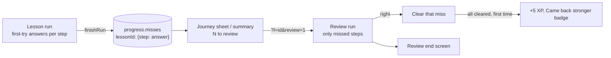

# Review what I missed (Part 2 of 5)

*   **Author:** Powellgraham5
*   **Status:** Built (8 Nov 2026). Approved by the author section by section the same day.
*   **Date:** 2026-11-08

--------------------------------------------------------------------------------

## Overview

Learners replay lessons to relearn what they did not understand, or to refresh before something like a job interview (owner, 8 Nov). Today a replay plays the whole 7-step lesson again. This design turns replay into **Review what I missed**: the learner practises only the questions they got wrong, and fixing them all is rewarded (D8, D14 and D16 in [docs/open-questions.md](../open-questions.md)). Full replay stays as a small secondary option.

It builds on Part 1 ([prototype-settings-labels-storage.md](prototype-settings-labels-storage.md)), whose storage upgrade already added an empty missed-questions record to every learner's progress.

## The Problem

*   **Replay does not match why people replay.** A learner who missed one calculation has to sit through all seven steps, including the four they already know.
*   **Misses are thrown away.** The app records which questions were right on the first try during a lesson, but deletes that record when the lesson ends. Only the overall percentage survives, so nothing knows which questions to practise.
*   **Getting better is not rewarded.** Replays earn 2 XP once a day whatever happens. The game rules already have an "improvement" reward (5 XP) and a "Came back stronger" badge, but the app never uses them; the badge is always locked.
*   **Learners who finished lessons before this change have no stored misses.** They need a sensible option too.

## Goals

*   **Misses are kept.** When a lesson ends, every question answered wrong on the first try is stored for that lesson, with the learner's answer.
*   **Review what I missed** plays only those questions, in lesson order, with the usual feedback and explanations.
*   **A miss clears when answered right** in a review. Questions still wrong stay for next time.
*   **Fixing every miss in a lesson** gives +5 XP once per lesson, ever, and unlocks the "Came back stronger" badge.
*   **Reviewing still counts for the day:** the existing 2 XP once per lesson per day and a streak day apply to reviews, as they do to replays now.
*   **Full replay stays** as a small link, and is the only option for a lesson with no stored misses (a perfect score, or a lesson finished before this change).
*   **The rules live in the tested domain package** so they carry into Phase 2, with tests for each.
*   **Clear entry points:** the journey's finished-lesson node and the lesson summary show how many questions are waiting ("2 to review").
*   **A review has its own end screen,** in the style of the after-lesson celebrations: when every miss is fixed, a "Came back stronger" moment (Fin powers up, the badge pops in, +5 XP rolls up); when some remain, a calm screen saying how many are left. Mock-up first.

## Non-Goals

*   **Spaced repetition** ("still remembered days later" checks). Rejected by the owner (D16).
*   **A separate quick refresher** of explainer steps. Full replay already does this job.
*   **Reviewing boss, daily-question or micro-module misses.** This part covers the six World 1 lessons only.
*   **Changing lesson content or question wording.**
*   **New visual style.** Screens reuse the existing lesson steps; the new entry points get a mock-up before they are built.

## Decisions Made in Drafting

*   **Journey entry:** tapping a finished lesson with misses opens a small sheet: "Review what I missed (N)" and "Replay the whole lesson". A lesson without misses goes straight to the full replay, as today.
*   **One miss per step:** order and match steps count as one question each.
*   **Best score unchanged by reviews:** the best score records first attempts and full replays; reviews only clear misses.
*   **Review end screen:** its own celebration, mock-up first (owner, 8 Nov).

## Technical Plan (Architecture)

### 1. Rules in the domain package

New tested functions in `packages/domain/src/review.ts` (a new file: `learning.ts` depends on the engine package, which the browser bundle does not include), so the rules carry into Phase 2:

*   **Record misses** after a full lesson or full replay: take the steps answered wrong on the first try and add them to that lesson's misses, keeping the learner's answer. A step answered right in a full replay clears its miss.
*   **Plan a review:** given a lesson's flow and its misses, return the missed steps in lesson order.
*   **Apply a review:** steps answered right are cleared; steps still wrong stay. Returns how many remain and whether this review fixed the last one.
*   **Reward:** fixing the last miss of a lesson gives `XP.improvement` (5) once per lesson, ever; it is remembered so it never pays twice. The usual practice reward (2 XP once per lesson per Lagos day) and the streak day apply to every review and replay.

### 2. Stored data

*   `progress.misses[lessonId] = { stepKind: givenAnswer }`, added empty by the Part 1 upgrade. Step kinds (choice, order, match, scenario, calc) are stable keys within a lesson.
*   `progress.fixed[lessonId] = true` once the +5 has been paid, so it is paid once ever.
*   Lessons finished before this change have no misses; they offer full replay only.

### 3. Running a review

*   A review is a lesson run with a review flag and the list of steps to play. The lesson step screens already move to the next step in the flow; in a review they move to the next missed step instead, and the progress bar counts only the review's steps ("1 of 2").
*   Explainer, myth and compare steps are skipped in a review; they have no answers.
*   The halfway cheer and "in a row" label work as in a normal lesson.
*   At the end, the review goes to its own end screen instead of the lesson celebration.

### 4. Screens

*   **Journey sheet** (new): on a finished lesson with misses, a small sheet with the lesson title, "Review what I missed (N)" and "Replay the whole lesson".
*   **Lesson summary:** when the lesson has misses, a "Review what I missed (N)" button under the existing review of answers.
*   **Review end screen** (new board, built like the celebration screens): all fixed: Fin powers up, "Came back stronger" badge pops in, +5 XP rolls up, "Back to the journey"; some left: "N still to practise", what was fixed, "Back to the journey".
*   **History** names reviews "Lesson review".
*   **Me, Achievements:** the "Came back stronger" badge unlocks when a lesson's misses are all fixed.

## Alternatives Considered

*   **Keep full replay only.** Rejected: it makes a learner repeat what they already know, which does not serve relearning or interview preparation.
*   **A separate quick refresher of explainer steps.** Rejected by author (D16): full replay already covers it.
*   **Spaced repetition ("still remembered days later").** Rejected by author (D16): too much for a prototype.
*   **Pay the +5 bonus every time all misses are fixed.** Rejected: a learner could miss on purpose, then fix, to farm XP. Once per lesson, ever, rewards real improvement only.
*   **Let reviews raise the best score.** Rejected: a review plays only a few steps, so its percentage is not comparable with a full lesson.
*   **Count each part of an order or match step as its own miss.** Rejected: steps are answered as one action, and the lesson already scores them as one.
*   **Keep the rules in the app's glue code (`fv.js`).** Rejected: untested, and they would not carry into Phase 2.
*   **Go straight to the review from the journey, with a replay link inside.** Rejected by author: a small sheet with both choices is clearer.
*   **Name it "Practise my mistakes".** Rejected by author (D16): "Review what I missed" reads as less of a telling-off.

## Detailed Implementation

Five steps, in order; each ends with its checks. Paths are from the repository root. No production code is written in this design.

### Step 1: Rules and tests (domain package)

*   `packages/domain/src/learning.ts`: add `recordMisses(misses, lessonId, answers, given)`, `planReview(flow, missesForLesson)`, `applyReview(missesForLesson, answers)` (returns remaining misses, how many were fixed, whether the last one was fixed) and `reviewReward(fixedBefore, lastFixed)` (5 XP only when the last miss is fixed for the first time). Pure functions, no storage.
*   `packages/domain/src/index.ts`: already exports `learning`; no change unless the new functions need listing.
*   `packages/engine/src/rules.ts`: no change; `XP.improvement` (5) and `XP.lessonPractice` (2) are used as they are.
*   `packages/domain/src/domain.test.ts`: tests for: a first-try wrong step is recorded with its answer; a right step in a full replay clears its miss; a review plan lists missed steps in lesson order and skips steps without answers; a review clears right steps and keeps wrong ones; the bonus pays 5 once when the last miss is fixed and 0 afterwards; two reviews on one Lagos day pay the 2 XP practice reward once.
*   `apps/prototype/tools/build_fvd.mjs`: add `learning` to the compiled module list if it is not there; re-run to rebuild `apps/prototype/site/fvd.js`.
*   **Checks:** `npm test`, `npm run typecheck`.

### Step 2: Browser state (`fv.js`)

*   `apps/prototype/site/fv.js`:
    *   `finishRun`: after a first attempt or full replay, call `recordMisses` and save `progress.misses`. After a review, call `applyReview`, save the remaining misses, and pay `reviewReward` into XP and the log; set `progress.fixed[lessonId]` when the bonus is paid. Return what the end screen needs: fixed, remaining, bonus, lesson.
    *   `startRun`: `?review=1` together with `?l=<lesson id>` starts a review of that lesson's missed steps (only for a finished lesson with misses; otherwise it falls back to a full replay).
    *   `flowVals`: in a review, the step list is the review plan, so progress reads "Step 1 of 2" and Continue goes to the next missed step; after the last one it goes to `UPReviewDone.dc.html`.
    *   New `LOOP.missCount(lessonId)` for the entry points.
    *   Achievements: the "back" badge ("Came back stronger") turns on when any lesson has `progress.fixed` set.
    *   History: log reviews with the kind `review`.
*   **Checks:** a node script loads `fvd.js` and `fv.js` with seeded storage and runs a lesson with one wrong step, then a review that fixes it: misses go 1 to 0, XP rises by 2 + 5, a second review the same day pays nothing.

### Step 3: Screens

*   `apps/prototype/tools/build_review.py` (new): builds `apps/prototype/site/UPReviewDone.dc.html`, the review end screen, from the same template and motion code as `build_celebrate.py` (Fin's power-up, the badge, the XP roll-up, reduced-motion fallback). Two states: all fixed, and some left.
*   `apps/prototype/tools/wire_replay.py`: on `UPJourney.dc.html` and `UDJourney.dc.html`, a finished lesson with misses opens a small sheet ("Review what I missed (N)", "Replay the whole lesson") instead of going straight to the replay; lessons without misses keep going straight to the replay. On `UPLessonComplete.dc.html` and `UDyPLessonComplete.dc.html`, add a "Review what I missed (N)" button when the lesson has misses. On `UPHistory.dc.html` and `UDxHistory.dc.html`, name the `review` kind "Lesson review".
*   `apps/prototype/site/responsive.js`: no change expected; the "in a row" label and halfway cheer already read the run and the progress bar.
*   **Checks:** screenshots of the sheet, the summary button and both end-screen states at 280, 390, 820 and 1440 pixels; `wire_a11y.py` and axe-core show no new issues.

### Step 4: Mock-up gate

*   Before Step 3 is built, a mock-up of the journey sheet, the summary button and the two end-screen states is shown to the owner for approval, per the owner's rule for new screens and animation.

### Step 5: Rebuild, regression and docs

*   `apps/prototype/tools/README.md`: add `build_review.py` after `build_celebrate.py`.
*   `apps/prototype/site/sw.js`: regenerated last.
*   `docs/open-questions.md`: mark D8, D14 and D16 as built.
*   `docs/PHASE1_STATUS.md`: describe Review what I missed under Learning.
*   `docs/designs/SITEMAP.md`: add this design.
*   **Checks:** the full regression (all six lessons, celebration, in-lesson cheers, replay, Library, daily loop, Me, Ask Fin, checkout, simulator, admin, emails, Part 1 checks) passes at 390 and 1440 with no page errors; a new review walk-through passes: miss a step, review it, fix it, see the end screen, see the badge unlocked, see no second bonus.

## Open Questions

*   None for this part.
